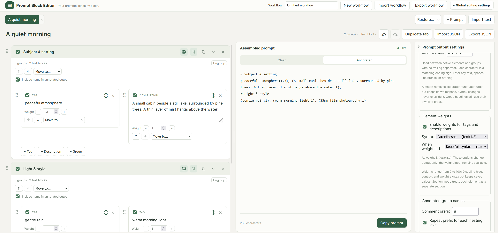

# Prompt Block Editor

A visual prompt editor for image and video generation. Organize tags and descriptions into blocks, group related elements, toggle them on or off, and drag to reorder while previewing the assembled text.

The editor runs locally in a browser or Tauri desktop window. No account, AI service, or ComfyUI installation is required. Copy the finished text into your preferred generator.



## Main features

- Tags, multiline descriptions, and nested groups with independent enable/disable controls.
- Drag-and-drop ordering, keyboard movement controls, and group duplication.
- Multiple named prompt tabs, with duplication, manual sorting, archiving, and restoration.
- Live Clean or Annotated output with configurable separators, headings, and optional weights.
- Text import with a preview, local autosave, and JSON workflow backups.
- Resizable editor and preview panes, optional two-column groups, and per-prompt undo/redo.

## Quick start

Use Node.js 22 LTS and npm. From the project directory:

```sh
npm install
npm run dev
```

Open [http://127.0.0.1:1420](http://127.0.0.1:1420). Keep the development server running so the browser can load or reload the editor.

For a desktop window, also install a current stable Rust toolchain and, on Windows, Microsoft C++ Build Tools and WebView2. Then run:

```sh
npm run tauri dev
```

See the [development guide](docs/development.md) for checks, code structure, and desktop build notes.

## Basic workflow

1. Name the workflow and use **+ Prompt** to add a tab, or **Import text** to turn an existing prompt into blocks after reviewing a preview.
2. Add tags, descriptions, and groups. Drag to arrange them, and disable elements you want to exclude. Collapsing a group only changes its display.
3. Open **Prompt output settings** beside the preview to configure this prompt's separators, headings, and weight syntax. **Global editing settings** controls shared editing preferences.
4. Choose **Clean** for text without group headings, or **Annotated** to include enabled headings. Annotated headings are literal text; generators may not treat them as comments.
5. Use **Copy prompt** to copy the displayed output. Duplicate a tab or group when making an independent variation.

## Saving and backups

The active workflow autosaves in this browser or desktop webview, including prompt contents, output settings, tab order, archived prompts, and the selected tab. Autosave uses local storage; it is not a file backup or cross-device sync. Global editing preferences are saved separately and are not included in exports.

Use **Export workflow** for a portable backup and **Import workflow** to restore it. **New workflow** immediately replaces the workspace with one empty prompt and autosaves it. Export first if you want to keep the current workflow separately.

| Action          | What it does                                                                                               |
| --------------- | ---------------------------------------------------------------------------------------------------------- |
| Import workflow | Replaces the workspace with a validated workflow, including its prompt settings; resets session histories. |
| Export JSON     | Downloads the current prompt document and its output settings.                                             |
| Import JSON     | Replaces current-tab document content and can be undone; does **not** restore exported output settings.    |
| Import text     | Previews parsed tags, flat groups, and optional weights, then creates a new tab.                           |

For complete restoration, use workflow export/import. See the [usage guide](docs/usage.md) for recovery, settings, formatting rules, and import details.

## Current limitations

One workflow is active at a time. Undo/redo history lasts only for the session and records individual edits, including keystrokes; output settings and tab management are outside that history. Text import uses explicit parsing rules without AI, sentence detection, or nesting inference. Weight syntax support depends on the target generator.

Reusable block libraries, inline editable description pieces, native file dialogs, and keyboard undo shortcuts are not implemented. Installer bundling is disabled pending distribution setup.

## License

MIT — see [LICENSE](LICENSE).
